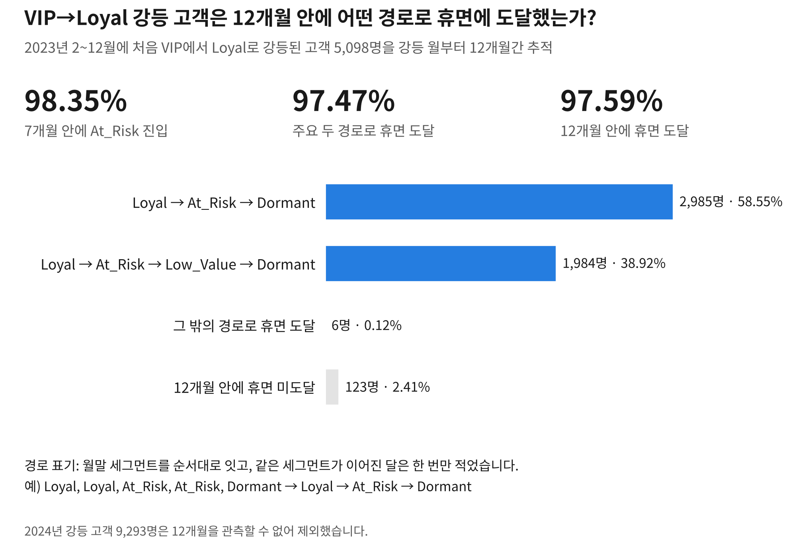
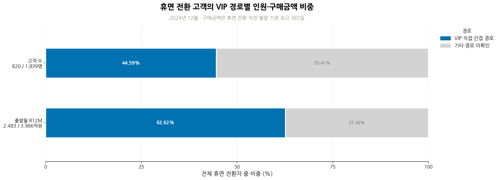

# 국내 패션 이커머스 고가치 고객 이탈 예방: RFM 전이 분석, CRM 설계, A/B 테스트

국내 패션 이커머스를 가정한 시뮬레이션 데이터로 핵심 매출 고객이 휴면으로 이동하는 경로를 추적하고, 이를 막기 위한 CRM과 효과 검증용 A/B 테스트, 손익분기·ROI를 설계한 프로젝트입니다.

- 분석 보고서(Notion): [국내 패션 이커머스 시뮬레이션 데이터 분석](https://taehokim-portfolio.notion.site/d94aada316698282af6581a3b244432b)
- 데이터 생성 설계(Notion): [데이터 생성 시나리오 및 구조 설계](https://taehokim-portfolio.notion.site/404aada3166980909c35fd58c6c06bd8)
- 기간: 2025.12 ~ 2026.02 (2인 팀)
- 사용 기술: Python(pandas, NumPy, SciPy, statsmodels, matplotlib), MySQL

## TL;DR

- **문제:** 연간 구매 고객 수 성장률이 2023년 109.8%에서 2024년 11.8%로 낮아졌습니다.
- **발견:** VIP에서 Loyal로 강등된 고객 5,098명의 12개월간 세그먼트 이동을 추적한 결과, 97.47%가 두 경로(Loyal→At_Risk→Dormant, Loyal→At_Risk→Low_Value→Dormant)로 휴면 전환되었습니다.
- **액션:** 마지막 구매 후 45일이 지난 VIP부터 3단계 CRM을 적용하도록 설계했습니다. 두 A/B 테스트가 최소 검출 효과(MDE) 수준으로 개선되면 연간 순이익은 약 3,312만원, ROI는 약 232%로 추정됩니다.

## 기획 의도

### 분석 질문

이 프로젝트는 "누구를, 언제 관리해야 핵심 매출 고객의 휴면 전환을 막을 수 있는가"라는 질문에서 시작했습니다. 플랫폼 매출 분석에서 2024년 매출 성장 둔화의 주요 요인이 구매 고객 수의 성장 둔화로 확인되었기 때문에, 구매 고객 기반이 어떤 경로로 약해지는지를 고객 상태 변화로 확인하고자 했습니다.

### 시뮬레이션 데이터를 사용한 이유

고객, 주문, 행동 로그가 같은 고객 기준으로 연결되고 수년간 누적된 데이터가 필요했습니다. 공개 데이터셋 Olist는 구매 이전 행동 로그가 제한적이고, Retailrocket은 분석 기간과 고객·거래 정보가 제한적이었습니다. 네이버 커머스 API와 쿠팡 OPEN API는 별도의 인증과 권한이 필요해 분석 목적으로 자유롭게 확보할 수 없었습니다. 따라서 Google BigQuery의 공개 데이터셋 thelook_ecommerce의 스키마를 참고해, 국내 패션 이커머스를 가정한 데이터를 직접 생성했습니다.

### 결과의 해석 범위

분석 결과는 데이터 생성 규칙과 시나리오의 영향을 받습니다. 따라서 실제 시장이나 특정 기업의 현상으로 일반화하지 않고, 시뮬레이션 환경 안에서의 결과로 해석합니다. 이 레포의 목적은 월말 RFM 스냅샷 기반 전이 분석, 코호트 통제 검증, A/B 테스트 설계, 손익분기 계산과 같은 분석 절차를 검증 가능한 형태로 보여 주는 것입니다.

## 핵심 분석 결과

**1. 매출 성장을 이끌던 구매 고객 수의 증가세가 둔화되었습니다.**
2024년 매출은 약 171억원으로 늘었지만 매출 성장률은 전년 119.5%에서 27.3%로 낮아졌고, 연간 구매 고객 수 성장률도 109.8%에서 11.8%로 낮아졌습니다.

**2. 휴면으로 전환하는 고객이 늘었고, 이들의 과거 구매가치도 커졌습니다.**

| At_Risk → Dormant 전환 | 2023년 2월 | 2024년 12월 | 변화 |
|---|---:|---:|---:|
| 휴면 전환율 | 4.67% | 11.20% | +6.54%p |
| 실제 휴면 전환 인원 | 76명 | 716명 | 9.42배 |
| 전환자 1인당 과거 구매금액(R12M) | 33.4만원 | 41.1만원 | +22.97% |
| 전환자 과거 구매금액 합계 | 0.254억원 | 2.941억원 | 11.59배 |

가입연도 코호트 구성비를 고정해도 휴면 전환율은 관측된 상승 폭(6.54%p)보다 큰 12.09%p 상승했습니다. 고객 구성 변화만으로는 전환율 상승을 설명할 수 없습니다.

**3. VIP에서 Loyal로 강등된 고객은 대부분 두 경로로 휴면에 도달했습니다.**
2024년 매출의 79.8%를 차지한 VIP와 Loyal을 대상으로 후속 상태를 추적했습니다. 12개월 완전 추적이 가능한 5,098명 중 58.55%는 Loyal→At_Risk→Dormant, 38.92%는 Loyal→At_Risk→Low_Value→Dormant 경로로 휴면에 도달했습니다.



**4. 휴면 전환자의 과거 구매금액 중 62.62%가 VIP 이탈 경로에 집중되었습니다.**
2024년 12월 휴면 전환자 1,839명 중 VIP 두 경로를 거친 고객은 820명(44.59%)이었지만, 이들의 휴면 전환 직전 최근 365일 구매금액은 2.483억원으로 전체의 62.62%였습니다.



## CRM 실행안

| 단계  | 대상    | 시점                       | 액션                                                                                                             |
| --- | ----- | ------------------------ | -------------------------------------------------------------------------------------------------------------- |
| 1차  | VIP   | 마지막 구매 후 45일             | 관심 신호 유형별 콘텐츠를 할인 없이 보냅니다.<br>- 장바구니 이력이 있거나 최근 본 상품이 있으면 앱 푸시<br>- 활동이 없으면 브랜드메시지 혹은 이메일로 마지막 구매 브랜드의 신상품을 안내 |
| 2차  | VIP   | 강등 판정 월 초(월말 경과일 60일 이상) | 이번 달 말까지 N원 구매하면 VIP가 유지된다는 등급 하락 예고를 알림톡으로 보냅니다.                                                              |
| 3차  | Loyal | 강등 판정 후 약 1개월            | 1회 구매 시 VIP 복귀 안내와 2주 한정 20% 할인 쿠폰을 광고 수신 동의 고객에게 보냅니다.                                                        |

유효 구매가 발생하면 시나리오를 즉시 중단하고, 3차 기한이 끝나면 At_Risk 단계 관리로 넘깁니다.

**설계 근거**
1. VIP 강등의 97.4%는 마지막 구매 후 경과일이 늘어난 Recency 저하로 발생했고, 강등 고객의 97.2%는 At_Risk까지 강등되었습니다. 따라서 Loyal 강등 이전부터 개입합니다.
2. 강등 고객의 73.2%는 강등 전 VIP 구간에 플랫폼을 다시 방문했지만, 강등 후 Loyal 구간에서는 3.2%만 방문했습니다. 그래서 접점이 남아 있는 VIP 단계에서 할인 없는 1·2차를 먼저 보냅니다.
3. 1차 메시지를 늦게 보낼수록 대상 중 실제로 강등되는 비율은 높아지지만, 강등 판정까지 대응할 시간은 줄어듭니다. 마지막 구매 후 45일에 보내면 대상의 70.7%가 강등되고 판정까지 61일(중앙값)이 남으며, 60일에 보내면 84.2%가 강등되고 46일이 남습니다(구매 건 기준). 1차는 할인이 없어 대상이 넓어도 비용이 적으므로, 후보 구간(45~60일) 중 가장 이른 45일에 보냅니다.
4. 3차는 할인 쿠폰이 포함되므로, 개입이 없어도 스스로 돌아올 고객에게 쿠폰이 나가지 않도록 늦게 보냅니다. 강등 후 스스로 재구매한 고객의 79.0%가 강등 판정 후 30일 안에 구매했기 때문에, 3차는 강등 판정 다음 달 말일(판정 후 약 1개월)에 보냅니다.

## A/B 테스트 설계

| 구분    | 실험 1: VIP 강등 예방 (1·2차)       | 실험 2: 강등 고객의 VIP 복귀 (3차)               |
| ----- | ---------------------------- | -------------------------------------- |
| 대상    | 마지막 구매 후 45일 동안 재구매하지 않은 VIP | 판정 다음 월말까지 구매 없이 Loyal에 머문 광고 수신 동의 고객 |
| 주 지표  | 판정 시점 강등률                    | 180일 도달 전 재구매율                         |
| 기준값   | 70.1%                        | 0.45%                                  |
| MDE   | −4.04%p (70.1% → 66.1%)      | +1.13%p (0.45% → 1.58%)                |
| 표본 수  | 그룹당 2,091명 (모집 4개월)          | 그룹당 1,326명 (모집 7개월)                    |
| 검정 방법 | 두 비율 양측 z검정                  | Fisher 정확검정(양측)                        |

기준값은 CRM이 없던 과거 데이터에서 관측한 값입니다. MDE는 유의수준 5%, 검정력 80%에서 모집 기간별 예상 표본으로 계산했고, 한 달 더 모집해도 MDE가 10% 미만으로 줄어드는 첫 기간을 모집 기간으로 정했습니다. 두 실험 모두 고객 단위로 한 번만 배정하고 배정 고객 전원을 분석(ITT)합니다.

## 손익분기와 ROI

두 실험이 각각 MDE 수준으로 개선된다고 가정한 연간 추정치입니다.

| 구분 | 1·2차 (실험 1) | 3차 (실험 2) | 합계 |
|---|---:|---:|---:|
| 개선 효과 | 강등 방지 약 416명 | 추가 재구매 약 51건 | – |
| 총비용 | 549만원 | 약 877만원 (할인비 약 315만원 포함) | 약 1,426만원 |
| 순이익 | 약 3,570만원 | 약 −258만원 | 약 3,312만원 |
| ROI | 약 651% | 약 −29% | 약 232% |
| 손익분기점 | 강등률 −0.54%p | 재구매율 +1.93%p | – |

1·2차는 강등률을 0.54%p만 낮춰도 비용을 회수합니다. 3차는 손익분기점(+1.93%p)이 MDE(+1.13%p)보다 높아 MDE 수준에서는 손실이 발생하므로, 실험 결과에 따라 할인율과 혜택을 다시 설계해야 합니다. 이 수치는 실제 성과가 아니라, 추가 구매 1건의 이익이 과거 평균과 같다고 가정한 계산값입니다.

## 나의 역할

2인 팀 프로젝트에서 다음 작업을 직접 수행했습니다.

- 국내 패션 이커머스 시뮬레이션 데이터 생성 로직 설계와 구현
- RFM 스코어링 기준과 세그먼트 규칙 설정, 세그먼트 간 이질성 검증
- 월말 RFM 스냅샷 기반 세그먼트 전이 분석과 휴면 경로 추적
- 프로젝트 결론 도출과 CRM 전략 설계
- A/B 테스트 설계와 손익분기·ROI 산정

## 분석 과정

| 순서 | 노트북 | 내용 |
|---|---|---|
| 0 | [00_prep_region_population](notebooks/00_prep_region_population.ipynb) | KOSIS 시군구 성별 인구 통계를 데이터 생성용으로 정리합니다. |
| 0 | [00_collect_visitor_stats](notebooks/00_collect_visitor_stats.ipynb) | 지역별 월간 방문자 통계를 수집합니다. |
| 1 | [01_generate_simulated_data](notebooks/01_generate_simulated_data.ipynb) | 6개 테이블의 시뮬레이션 데이터를 생성합니다. |
| 2 | [02_load_to_mysql](notebooks/02_load_to_mysql.ipynb) | 생성한 데이터를 MySQL에 적재하고 인덱스를 만듭니다. |
| 3 | [03_rfm_segmentation_validation](notebooks/03_rfm_segmentation_validation.ipynb) | RFM 스코어링 기준과 세그먼트 규칙을 정하고 이질성을 검증한 뒤, 월말 RFM 스냅샷을 저장합니다. |
| 4 | [04_rfm_transition_churn_paths](notebooks/04_rfm_transition_churn_paths.ipynb) | 구매빈도·객단가 분해, 휴면 구조 분해, 코호트 통제 검증, VIP→Loyal 경로 추적을 수행합니다. |
| 5 | [05_crm_ab_test_roi](notebooks/05_crm_ab_test_roi.ipynb) | CRM 개입 시점과 대상을 정하고, A/B 테스트 표본·MDE와 손익분기·ROI를 계산합니다. |

### RFM 세그먼트 기준

각 월말 시점의 최근 365일 구매 이력으로 R·F·M 점수를 계산합니다. Recency와 Frequency는 고정 구간으로 점수를 주고, Monetary는 매월 최근 365일 구매 고객의 금액 5분위로 점수를 줍니다. 세그먼트는 Dormant, VIP, Loyal, At_Risk, Potential, Low_Value, Regular 순서로 배정합니다. 상세 기준은 분석 보고서의 「1-2. 데이터 및 세그먼트 정의」에 정리했습니다.

### 데이터 생성 요약

고객 한 명을 상태를 가진 개체로 두고, 세션 단위로 방문·탐색·장바구니·구매·반품을 확률분포에서 생성하는 규칙 기반 시뮬레이션입니다. 재방문 간격은 고객 등급별로 지수분포와 로그정규분포를 사용했고, 이탈은 세션마다 이탈 확률을 적용했으며, 등급 변화는 최근 활동의 지수가중이동평균(EWMA)으로 판단했습니다. 지역 분포는 KOSIS 시군구 인구통계를, 테이블 구조는 thelook_ecommerce를 참고했습니다. 난수 시드는 42로 고정했습니다.

| 테이블 | 단위 | 규모 |
|---|---|---:|
| users | 고객 1명 | 103,648행 |
| products | 상품 1개 | 30,000행 |
| promotions | 프로모션 1개 | 15행 |
| events | 행동 이벤트 1건 | 15,366,289행 |
| orders | 주문 1건 | 280,340행 |
| order_items | 주문 상품 1건 | 548,676행 |

데이터 기간은 2022년 1월부터 2024년 12월까지이며, 고객 상태 분석은 과거 구매 이력을 확보하기 위해 2023년 1월부터 수행했습니다.

### 재현 방법

1. 필요한 패키지를 설치합니다.
   ```bash
   pip install pandas numpy scipy statsmodels pingouin scikit-posthocs scikit-learn matplotlib seaborn koreanize-matplotlib squarify faker pyarrow sqlalchemy pymysql requests python-dateutil
   ```
2. `notebooks/01_generate_simulated_data.ipynb`를 실행해 `data/` 폴더에 데이터를 생성합니다. 생성 데이터는 용량이 커서 레포에 포함하지 않았습니다.
3. MySQL에 적재하려면 환경변수 `MYSQL_PASSWORD`를 설정한 뒤 `02_load_to_mysql.ipynb`를 실행합니다. 03~05 노트북은 `data/` 폴더의 파일을 직접 읽으므로 이 단계는 선택입니다.
4. `03` → `04` → `05` 순서로 실행합니다. 03이 저장한 `data/snapshots_df.parquet`를 04와 05가 사용하며, 차트와 집계 파일은 `outputs/`에 저장됩니다.

`00_collect_visitor_stats.ipynb`는 공공데이터포털 인증키가 필요하므로 환경변수 `DATA_GO_KR_SERVICE_KEY`로 전달합니다. 수집 결과인 `data/visitor_stats_by_city_month.csv`는 레포에 포함되어 있어 이 노트북을 실행하지 않아도 데이터를 생성할 수 있습니다.

## 한계

- 시뮬레이션 데이터는 실제 고객의 복잡한 구매 행동과 경기 변동, 경쟁사 이슈 같은 외부 요인을 모두 반영하지 못합니다.
- 방문 간격, 이탈 확률, 등급 전이 확률 같은 행동 파라미터는 가정값입니다. 파라미터 민감도 분석은 수행하지 않았습니다.
- 과거 CRM 운영 기록이 없어 실제 효과는 알 수 없습니다. ROI는 MDE 수준의 효과를 가정한 계산값이며, 실제 효과는 A/B 테스트로 확인해야 합니다.
- 인건비 배분, 발송 단가, 광고 수신 동의율(50%)은 실제 운영 데이터가 아닌 가정값이며, 물류·결제 수수료는 비용에 반영하지 않았습니다.
- 가입연도, 가입 후 경과기간, 측정 시점은 서로 독립이 아니어서, 휴면 전환율 상승을 "2024년이라서"와 "고객이 오래되어서"로 완전히 분리할 수 없습니다.

**외부 데이터 출처**

- 행정안전부, 「주민등록인구현황」, 행정구역(시군구)별 성별 인구수, 2025년 5월. KOSIS 국가통계포털, [https://kosis.kr/statHtml/statHtml.do?orgId=101&tblId=DT_1B040A3](https://kosis.kr/statHtml/statHtml.do?orgId=101&tblId=DT_1B040A3) (참조일: 2025.06.23)
- `data/행정구역별_성별_인구통계_2025.csv`는 위 통계표에서 시도 합계 행과 인구 0인 행을 제외하고 열 이름을 바꾼 파일이며, 수치는 원자료와 같습니다.